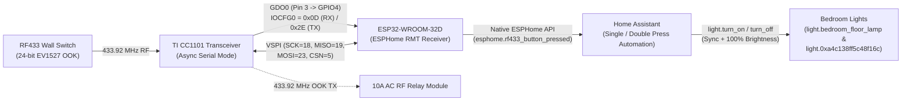
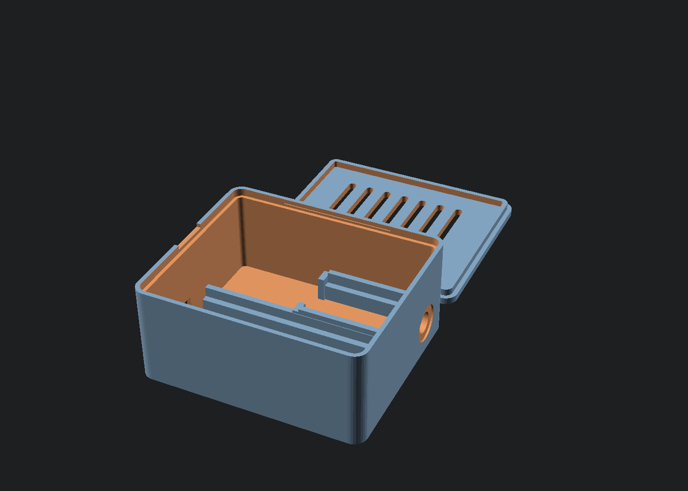

# ESP32 + TI CC1101 433.92 MHz RF Bridge for Home Assistant (ESPHome)

A complete, low-latency **433.92 MHz ASK/OOK (EV1527 / PT2262) RF Bridge** built with an **ESP32 (`ESP32-D0WD-V3` / `esp32dev`)**, a **TI CC1101 8-pin transceiver**, and **ESPHome** for native Home Assistant integration.

---

## 1. Architecture Overview



---

## 2. Hardware & Pin Mapping

| CC1101 Pin | Signal | ESP32 GPIO | Direction (RX) | Function |
| :--- | :--- | :--- | :--- | :--- |
| **Pin 1** | `GND` | `GND` | — | Common Ground |
| **Pin 2** | `VCC` | `3.3V` | — | **3.3V Power Only** *(Never connect to 5V)* |
| **Pin 3** | `GDO0` | `GPIO 4` | CC1101 -> ESP32 | Async Serial Data I/O (OOK pulse train RX & TX) |
| **Pin 4** | `CSN` | `GPIO 5` | ESP32 -> CC1101 | VSPI Chip Select (`SS`) |
| **Pin 5** | `SCK` | `GPIO 18` | ESP32 -> CC1101 | VSPI Clock |
| **Pin 6** | `MOSI` | `GPIO 23` | ESP32 -> CC1101 | VSPI Master Out Slave In (`SI`) |
| **Pin 7** | `MISO` | `GPIO 19` | CC1101 -> ESP32 | VSPI Master In Slave Out (`SO` / `GDO1`) |
| **Pin 8** | `GDO2` | *Unconnected* | — | Unused (Single-wire `GDO0` mode) |

---

## 3. Key Technical Details & CC1101 Register Fixes

### 3.1 Routing Asynchronous Serial RX Output to `GDO0` (`IOCFG0 = 0x0D`)
By default, `SmartRC-CC1101-Driver-Lib`'s `setCCMode(0)` writes:
- `CC1101_IOCFG2 (0x00) = 0x0D` (routing demodulated RX serial data to **Pin 8 / `GDO2`**)
- `CC1101_IOCFG0 (0x02) = 0x2E` (setting **Pin 3 / `GDO0`** to High-Z tri-state)

Because our hardware connects only **`GDO0` (Pin 3)** to `GPIO 4` and leaves `GDO2` (Pin 8) unconnected, `on_boot` explicitly overrides `IOCFG0` (`0x02`) to `0x0D` in RX mode:
```cpp
ELECHOUSE_cc1101.SpiWriteReg(CC1101_IOCFG0, 0x0D); // 0x0D = Async Serial Data Output on GDO0
ELECHOUSE_cc1101.SetRx();
```

### 3.2 Arduino ESP32 Core 3.x `MISO` Pull-Up & `SRES` Initialization Order
On `framework-arduinoespressif32 @ 3.2.1` (ESP-IDF 5.4), calling `ELECHOUSE_cc1101.getCC1101()` *before* `ELECHOUSE_cc1101.Init()` can read `0x00` on `MISO` (`GPIO 19`) before the CC1101 receives its `CSN` power-on reset pulse and `SRES (0x30)` command strobe. Enabling `pinMode(19, INPUT_PULLUP)` and running `Init()` prior to reading status registers reliably verifies:
- `PARTNUM (0x30) = 0x00`
- `VERSION (0x31) = 0x14` (TI CC1101 hardware revision `0x14`)
- `IOCFG0  (0x02) = 0x0D` (Serial Data Output)
- `MARCSTATE (0x35) = 0x0D` (`RX` state)

### 3.3 Sharing `GPIO 4` (`GDO0`) for RX and TX Without RMT Pin Contention
If ESPHome's `remote_transmitter` and `remote_receiver` are both bound to `GPIO 4`, the ESP32 RMT TX driver actively holds `GPIO 4` LOW (`0V`) when idle, shorting out incoming OOK pulses from `GDO0`.
To allow both reception and transmission over a single `GDO0` wire (`GPIO 4`):
1. `remote_receiver` is given exclusive RMT RX ownership of `GPIO 4` (`GPIO.enable_w1tc = (1ULL << 4)`).
2. During RF transmission (`transmit_ev1527_code`), the ESP32 switches `IOCFG0` to `0x2E` (Async TX Input), calls `SetTx()`, temporarily enables `GPIO 4`'s output buffer via `GPIO.enable_w1ts = (1ULL << 4)` (which leaves the RMT RX input matrix routing intact), clocks out the 24-bit EV1527 frame (`[1, 3]` / `[3, 1]` + `[1, 31]` sync), and immediately releases `GPIO 4` (`GPIO.enable_w1tc = (1ULL << 4)`) and restores `IOCFG0 = 0x0D` + `SetRx()`.

---

## 4. Zero-Latency Single Press & Fast Double Press Logic

EV1527 wall switches transmit a continuous burst of 3–6 identical 24-bit packets (~40 ms apart) during a single button press.

In `esp32-cc1101-rf-bridge.yaml`:
- **Captured Wall Switch Code:** `101000001110011110100100` (`0xA0E7A4` -> 20-bit address `0xA0E7A`, 4-bit button `0x4`)
- **Burst Debouncing (`> 220 ms` gap):** The very first packet of a press fires immediately with **0 ms artificial delay**, while trailing packets in the same finger hold (`< 220 ms` apart) are ignored.
- **Single vs. Fast Double Press (`<= 1300 ms`):**
  - **1st Press (`action: "single_press"`):** Immediately fires `esphome.rf433_button_pressed` with `action: "single_press"`, toggling both Bedroom lights (`light.bedroom_floor_lamp` and `light.0xa4c138ff5c48f16c`) in sync while preserving their previous brightness.
  - **2nd Fast Press within 1.3s (`action: "double_press"`):** Immediately fires `esphome.rf433_button_pressed` with `action: "double_press"`, turning both Bedroom lights **ON at 100% brightness** (`brightness_pct: 100`).

---

## 5. 3D-Printable Snap-Fit Enclosure (`enclosure/`)



Located in [`enclosure/`](enclosure/), designed for **zero-support FDM printing** (PLA / PETG, 0.20 mm layer height on Bambu Lab A1):

- **[`enclosure/rf_bridge_print_plate.stl`](enclosure/rf_bridge_print_plate.stl)** — Combined single-plate STL with both the bottom case and snap-fit lid oriented flat on the build plate.
- **[`enclosure/rf_bridge_case_bottom.stl`](enclosure/rf_bridge_case_bottom.stl)** — Bottom enclosure (`68.8 × 58.8 × 30.2 mm` outer) featuring:
  - Dedicated **ESP32 DevKit cradle** (`55.2 × 29.2 mm` pocket with `3.5 mm` pin-clearance ledges) aligned with a front USB-C / Micro-USB cutout + overmold relief.
  - Dedicated **TI CC1101 8-pin module cradle** (`33.0 × 17.8 mm` anti-rotation rails) aligned with a rear **6.7 mm SMA bulkhead port** + `11.5 mm` hex nut/washer counterbore.
  - **28 mm internal vertical clearance** to comfortably house arched female-to-female Dupont jumper wires.
  - Two **M3 keyhole mounting slots** on the floor.
- **[`enclosure/rf_bridge_case_lid.stl`](enclosure/rf_bridge_case_lid.stl)** — Snap-fit ventilated lid with 7 cooling louvers, onboard LED sight hole, and side pry slot.
- **[`enclosure/esp32_cc1101_enclosure.scad`](enclosure/esp32_cc1101_enclosure.scad)** — Fully parametric OpenSCAD source.

---

## 6. Repository Files

- [`esp32-cc1101-rf-bridge.yaml`](esp32-cc1101-rf-bridge.yaml) — Main ESPHome configuration (self-contained, flashed to ESP32 and synced to ESPHome Dashboard).
- [`ha_automation_bedroom_lights.yaml`](ha_automation_bedroom_lights.yaml) — Home Assistant automation for synchronized Bedroom Light toggling and fast double-tap 100% brightness.
- [`cc1101_rf_bridge.h`](cc1101_rf_bridge.h) — Standalone C++ reference header for CC1101 SPI initialization and mode switching.
- [`compile_and_flash.py`](compile_and_flash.py) — Helper script that uploads the YAML to the ESPHome Dashboard server, streams the remote PlatformIO build, downloads `firmware.factory.bin`, and flashes `COM3` via `esptool`.
- [`enclosure/`](enclosure/) — Parametric OpenSCAD design + ready-to-print `.stl` files (`rf_bridge_print_plate.stl`, `rf_bridge_case_bottom.stl`, `rf_bridge_case_lid.stl`).
- [`secrets.yaml.example`](secrets.yaml.example) — Template for `secrets.yaml`.
